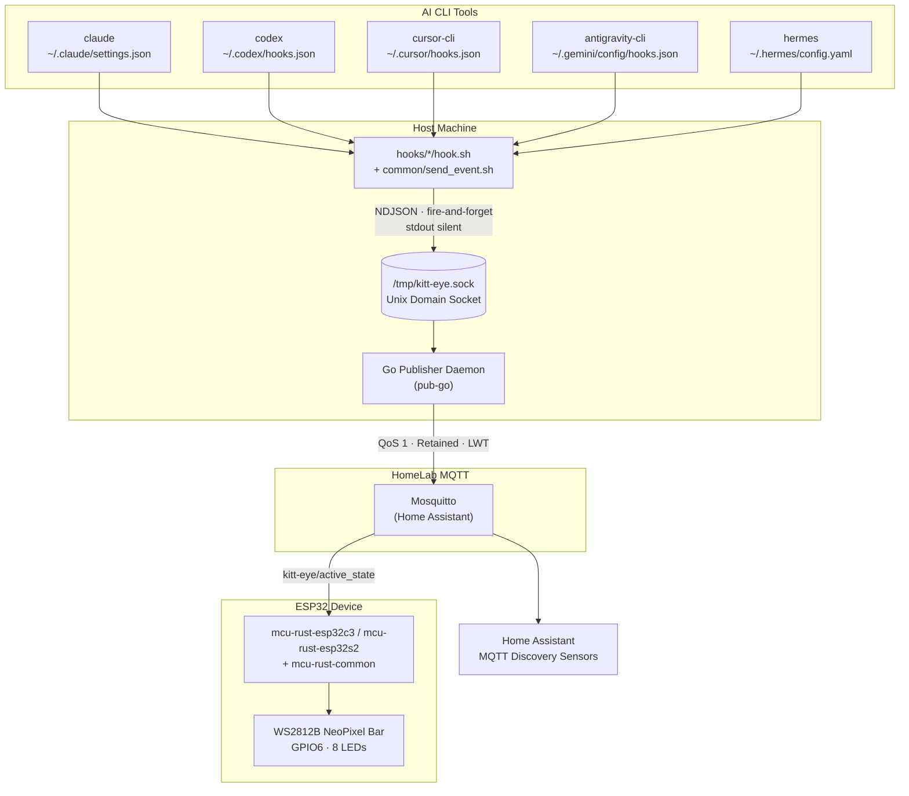
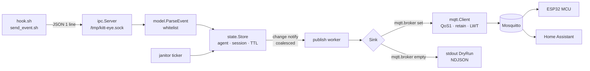
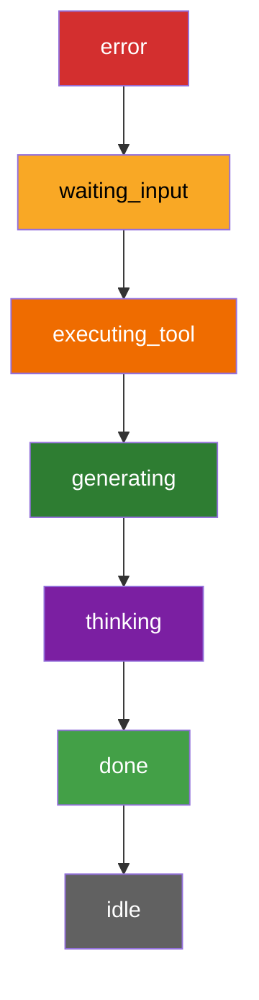
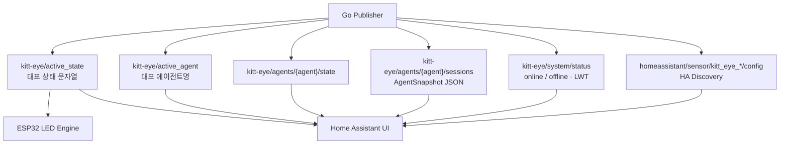
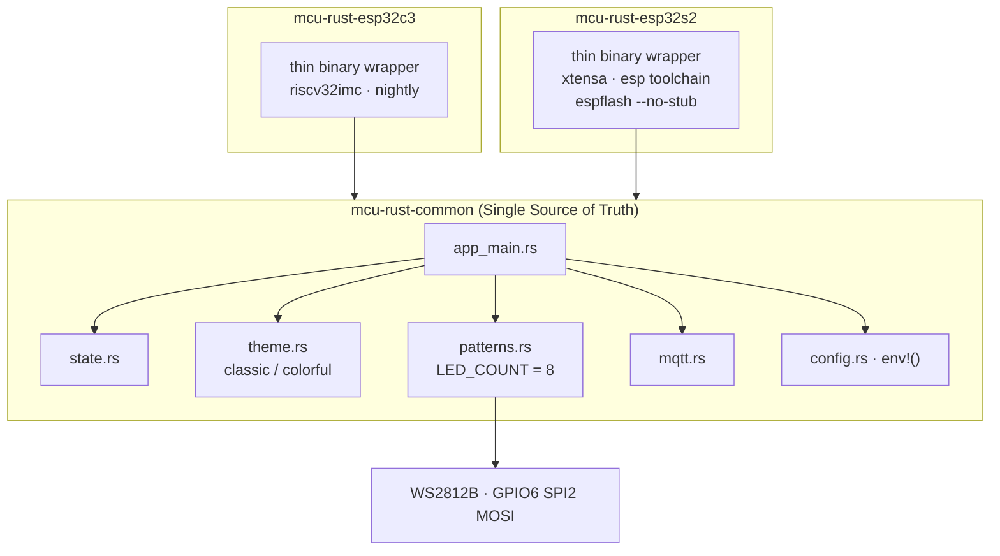
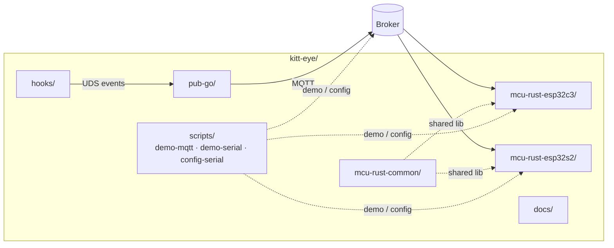

# kitt-eye Architecture

ASCII 아키텍처 설명을 Mermaid 다이어그램으로 시각화한 문서입니다.  
상세 프로토콜·상태 규칙은 [PLAN.md](../PLAN.md), 개발 제약은 [AGENTS.md](../AGENTS.md)를 참고하세요.


## 1. System Overview

AI CLI 훅 → Go Publisher → MQTT → ESP32 LED 바까지의 전체 파이프라인입니다.




## 2. Data Flow (Publisher Internals)

훅 이벤트가 데몬 내부에서 세션 집계·TTL·발행까지 흘러가는 경로입니다.




## 3. State Priority & TTL

여러 세션/에이전트가 동시에 활성일 때 `active_state`는 아래 우선순위로 결정됩니다.



| State | TTL / Expiration |
|---|---|
| `done` | `done_ttl` (default **15s**) → `idle` |
| `error` | `error_ttl` (default **60s**) → `idle` |
| active states | `stale_ttl` (default **300s**) no events → prune / `idle` |
| `idle` | `session_ttl` (default **3600s**) → session removed |

동률이면 가장 최근 갱신된 세션이 선택됩니다.


## 4. MQTT Topics

기본 prefix: `kitt-eye` (모두 QoS 1 + Retain).




## 5. MCU Firmware Layout

보드 패키지는 얇고, 애플리케이션 로직은 `mcu-rust-common`에 둡니다.



### Motion Themes (요약)

| State | classic | colorful |
|---|---|---|
| `idle` | Slow K.I.T.T. scanner (red) | Classic Red · Slow scanner |
| `thinking` | Center-out | Electric Violet |
| `generating` | Fill-sweep | Neo Mint Emerald |
| `executing_tool` | Fast scanner | Vivid Amber · Fast scanner |
| `waiting_input` | Blink | Warning Yellow |
| `done` | Flash → solid | Spring Lime |
| `error` | Comet | Crimson Red |


## 6. Repository Component Map




## 7. IPC Datagram Shape

Hooks → Publisher 한 줄 JSON 예시:

```json
{
  "agent": "claude",
  "state": "executing_tool",
  "detail": "Bash: npm test",
  "session_id": "abc12345",
  "event": "PreToolUse",
  "timestamp": "2026-09-12T17:00:00Z"
}
```

- 소켓: `/tmp/kitt-eye.sock`
- 전송: fire-and-forget (`nc -U`), 데몬 미기동 시 조용히 실패
- 훅 규칙: **stdout 무출력**, 부모 CLI에 영향 금지


## Related Docs

- [PLAN.md](../PLAN.md) — full architecture & protocol specification
- [AGENTS.md](../AGENTS.md) — agent/developer constraints
- [hardware_wiring.md](hardware_wiring.md) — ESP32 ↔ WS2812B wiring
- [esp32s2_usb_serial_plan.md](esp32s2_usb_serial_plan.md) — USB Serial CLI design
- [voice_system_design.md](voice_system_design.md) — optional voice playback
